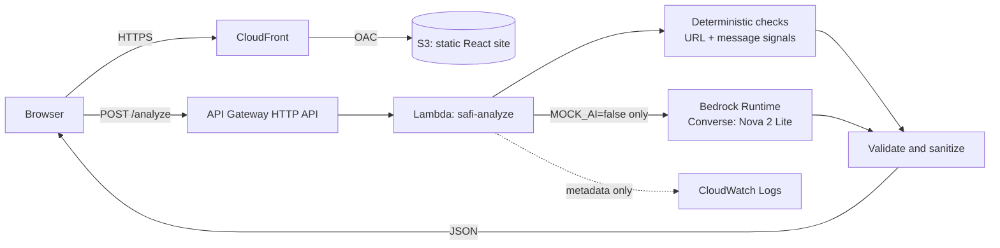

# Safi architecture

## Overview



## Request flow

1. The browser loads the static site from CloudFront. `config.json` (never cached) tells it the API URL.
2. The user submits a message, URL or screenshot to `POST /analyze`.
3. Lambda validates the request (type, size, image signature).
4. Deterministic checks always run first:
   - **URL signals:** HTTPS, IP host, shortener, punycode, subdomain depth, odd TLD, encoding tricks, `@` userinfo, length, credential-themed path, brand look-alikes.
   - **Message signals:** urgency, credential requests, fear, payment pressure, prizes, secrecy, click prompts, delivery themes.
5. If `MOCK_AI=true`, the rule engine builds the result. If `false`, the Bedrock adapter asks Nova 2 Lite for JSON, with the deterministic findings included as context.
6. Model output is parsed and validated. Server-owned fields (`assessmentMode`, `urlSignals`, `disclaimer`) are set by the server. Any failure falls back to the rule-based result.
7. The Risk Card is rendered. Nothing is stored.

## Design decisions

- **Deterministic first, AI second.** Safe, explainable signals are always available and work during the Bedrock verification hold. The model adds nuance and plain-language coaching.
- **Switch by configuration.** `MOCK_AI` is a Lambda environment variable. The frontend contract (`POST /analyze` and the response schema) is identical in both modes.
- **Prompt-based JSON, validated in code.** Nova 2 Lite has no native Structured Outputs, so we validate on our side rather than trusting the model.
- **No database.** The MVP has no need to persist anything, and not storing submissions is a privacy feature.
- **Single CloudFormation stack** keeps deployment reproducible and cheap: no NAT gateway, no always-on compute.

## Response schema

```json
{
  "riskLevel": "HIGH RISK | SUSPICIOUS | LOW RISK | UNABLE TO ASSESS",
  "threatType": "Credential phishing",
  "summary": "...",
  "whyRisky": ["..."],
  "indicators": ["..."],
  "recommendedActions": ["..."],
  "educationalTopic": "...",
  "confidence": "low | medium | high",
  "assessmentMode": "mock | ai",
  "urlSignals": ["..."],
  "urlChecks": { "isHttps": true, "usesIpAddress": false, "score": 0, "signals": [] },
  "disclaimer": "..."
}
```

`urlChecks` is an additive field with the structured URL results (`null` when no URL was checked).

## Cost profile

Pay-per-use only: Lambda, API Gateway, CloudFront, S3 storage, CloudWatch Logs (14-day retention). Throttling at the API stage caps request rates. Bedrock is called only when `MOCK_AI=false`.
